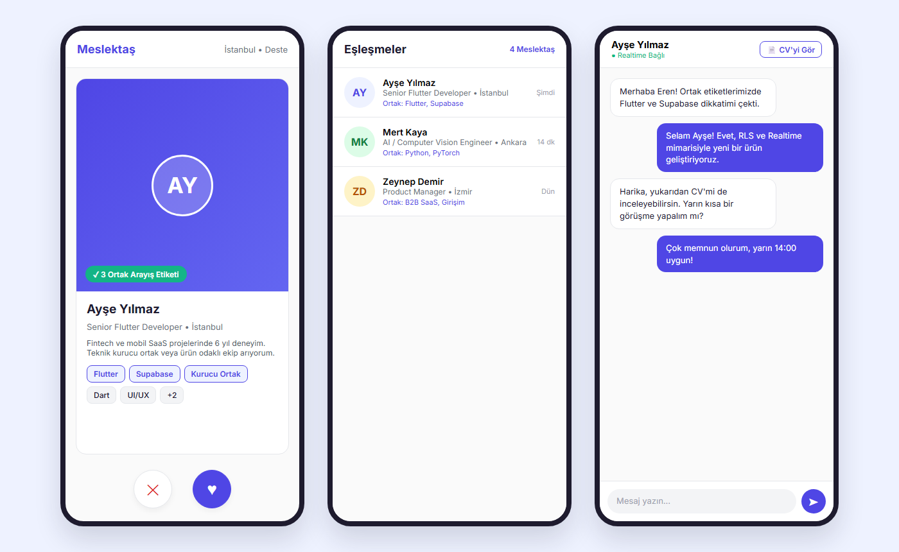
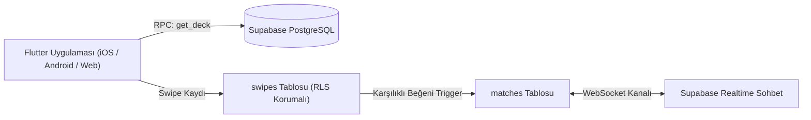

# 💼 Meslektaş — Profesyonel Yetkinlik Eşleşme ve Anlık Mesajlaşma Uygulaması


**Meslektaş**, LinkedIn tarzı profesyonel yetkinlik profillerini Tinder tarzı hızlı kart kaydırma (swipe) mekaniği ile birleştiren mobil öncelikli bir iş ağı uygulamasıdır. Kullanıcılar yetkinlik ve arayış etiketlerini seçer; deste bu etiketlerin örtüşmesine ve şehre göre puanlanıp sıralanır; karşılıklı beğeni otomatik eşleşme oluşturur ve eşleşen profesyoneller anlık mesajlaşır.

## 📸 Uygulama Ekran Görüntüleri (`DeckScreen` • `MatchesScreen` • `ChatScreen`)



---

## 🧠 Mimari ve Güvenlik (Serverless Supabase + RLS)



* **Veritabanı İçi Akıllı Sıralama (`get_deck()`):** Deste sıralaması istemcide değil, doğrudan PostgreSQL içindeki RPC fonksiyonunda ortak etiket sayısı ve şehir uyumuna göre hesaplanır.
* **Trigger Tabanlı Eşleşme:** Eşleşme kaydı istemci tarafından manipüle edilemez; karşılıklı beğeni oluştuğunda veritabanı tetikleyicisi (`trigger`) tarafından güvenli şekilde oluşturulur.
* **Row Level Security (RLS):** Tüm yetkilendirme doğrudan PostgreSQL satır düzeyi güvenlik politikalarıyla korunur.

---

## 🚀 Kurulum ve Çalıştırma

Uygulama Supabase bağlantı bilgilerini güvenlik amacıyla derleme zamanında (`--dart-define`) alır; kaynak kodda hiçbir anahtar tutulmaz:

```bash
flutter pub get

flutter run -d chrome \
  --dart-define=SUPABASE_URL=https://PROJE_ADRESINIZ.supabase.co \
  --dart-define=SUPABASE_ANON_KEY=SUPABASE_PUBLISHABLE_KEY
```

Veritabanı şemasını ve RLS politikalarını kurmak için Supabase SQL Editor üzerinde **[`docs/schema.sql`](docs/schema.sql)** dosyasını çalıştırmanız yeterlidir.

---

## 📁 Klasör Düzeni

```text
lib/
 ├── main.dart
 ├── screens/     # Uygulama ekranları (login, register, onboarding, deck, matches, chat, profile)
 ├── widgets/     # Tekrar kullanılan bileşenler (profil kartı, etiket chip'i, mesaj balonu)
 ├── services/    # Supabase erişim katmanı (auth, profile, swipe, chat)
 ├── models/      # Veri modelleri (Profile, Match, Message)
 ├── constants/   # Etiket havuzu, 81 il listesi ve ortam yapılandırması
 └── theme/       # Merkezi tema ve tasarım sabitleri
```

---

## 👨‍💻 Geliştirici
**Eren Sezer** — [GitHub Profilim](https://github.com/erensezer07-gif)
